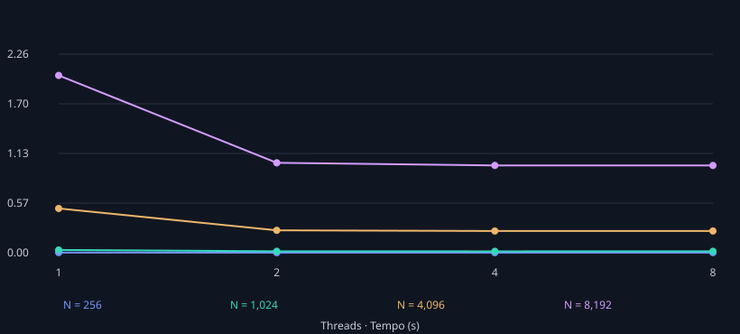
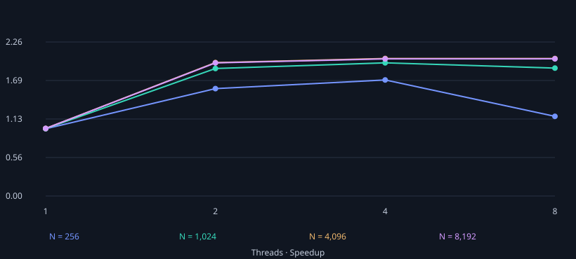
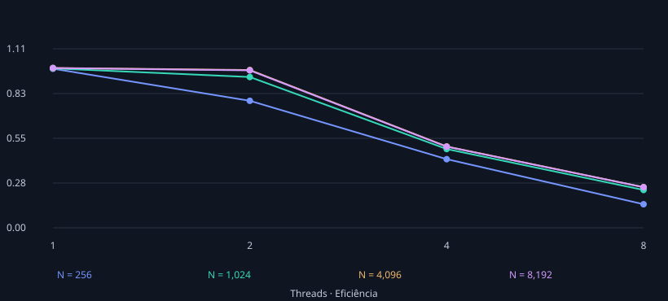

# Resultados medidos

Commit: `a3d14bcb6d6f879e47eec2f136bd48be5086d0eb`

CPU: Intel(R) Xeon(R) 6975P-C. CPUs lógicas: 4; afinidade: 4; quota: None. Memória: 16078424 kB.

Compilador: gcc (Ubuntu 13.3.0-6ubuntu2~24.04.1) 13.3.0. Flags: `-O3 -std=c11 -Wall -Wextra -ffp-contract=off; parallel: -fopenmp`.

Cinco repetições ou mais, uma execução de aquecimento por configuração e tamanho; ordem alternada deterministicamente. Tempo do kernel, incluindo criação da equipe e barreiras; sem E/S e alocação. Todas as saídas conferidas por SHA-256. Ambiente de CI compartilhado: não representa desempenho garantido em outro computador.

| N | Versão | Threads | Média (s) | Desvio (s) | Speedup | Eficiência |
|---:|---|---:|---:|---:|---:|---:|
| 256 | sequential | 1 | 0.001976 | 0.000017 | 1.000 | 100.0% |
| 256 | openmp | 1 | 0.002005 | 0.000006 | 0.986 | 98.6% |
| 256 | openmp | 2 | 0.001256 | 0.000017 | 1.574 | 78.7% |
| 256 | openmp | 4 | 0.001162 | 0.000007 | 1.700 | 42.5% |
| 256 | openmp | 8 | 0.001693 | 0.000022 | 1.167 | 14.6% |
| 1024 | sequential | 1 | 0.031274 | 0.000021 | 1.000 | 100.0% |
| 1024 | openmp | 1 | 0.031671 | 0.000044 | 0.987 | 98.7% |
| 1024 | openmp | 2 | 0.016740 | 0.000225 | 1.868 | 93.4% |
| 1024 | openmp | 4 | 0.016027 | 0.000019 | 1.951 | 48.8% |
| 1024 | openmp | 8 | 0.016687 | 0.000080 | 1.874 | 23.4% |
| 4096 | sequential | 1 | 0.499467 | 0.000210 | 1.000 | 100.0% |
| 4096 | openmp | 1 | 0.504500 | 0.000474 | 0.990 | 99.0% |
| 4096 | openmp | 2 | 0.255514 | 0.000234 | 1.955 | 97.7% |
| 4096 | openmp | 4 | 0.247909 | 0.000461 | 2.015 | 50.4% |
| 4096 | openmp | 8 | 0.247977 | 0.000212 | 2.014 | 25.2% |
| 8192 | sequential | 1 | 1.999162 | 0.000431 | 1.000 | 100.0% |
| 8192 | openmp | 1 | 2.020224 | 0.002210 | 0.990 | 99.0% |
| 8192 | openmp | 2 | 1.024901 | 0.002071 | 1.951 | 97.5% |
| 8192 | openmp | 4 | 0.994967 | 0.002415 | 2.009 | 50.2% |
| 8192 | openmp | 8 | 0.994579 | 0.001309 | 2.010 | 25.1% |

## Discussão

Para cada tamanho, o baseline é a versão sequencial compilada com as mesmas flags. O OpenMP com uma thread mede seu overhead. Casos com mais threads do que CPUs disponíveis estão marcados como oversubscribed no JSON e devem ser interpretados separadamente.

- N=256: melhor média OpenMP com 4 threads, speedup 1.70× e variação relativa 0.6%. Houve ganho de tempo médio.
- N=1024: melhor média OpenMP com 4 threads, speedup 1.95× e variação relativa 0.1%. Houve ganho de tempo médio.
- N=4096: melhor média OpenMP com 4 threads, speedup 2.01× e variação relativa 0.2%. Houve ganho de tempo médio.
- N=8192: melhor média OpenMP com 8 threads, speedup 2.01× e variação relativa 0.1%. Houve ganho de tempo médio.

O trabalho O(N²) das forças domina para N grande. As duas barreiras por passo, a criação da equipe, o trecho serial de E/S e a contenção de recursos limitam o ganho (Lei de Amdahl). A eficiência cai com oversubscription e com entradas pequenas. Uma diferença de médias menor que a dispersão exige mais repetições antes de concluir superioridade.

